# FuseRT: Understanding and Optimizing BERT Inference

FuseRT is an inference-optimization project built around BERT-base. It studies how a trained model is represented, simplified, compiled for an NVIDIA GPU, measured, and eventually improved with custom GPU kernels.

The project has two goals:

1. Make the model graph simpler before execution.
2. Find GPU operations that are still slow after TensorRT optimization and investigate custom fused kernels for them.

> This document records the current RTX 3060 baseline and the new RTX 5090 experiment. The original RTX 3060 project and results remain unchanged.

## 1. The complete pipeline

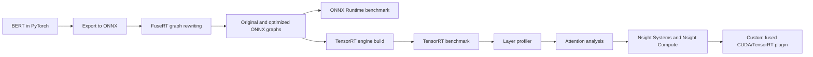

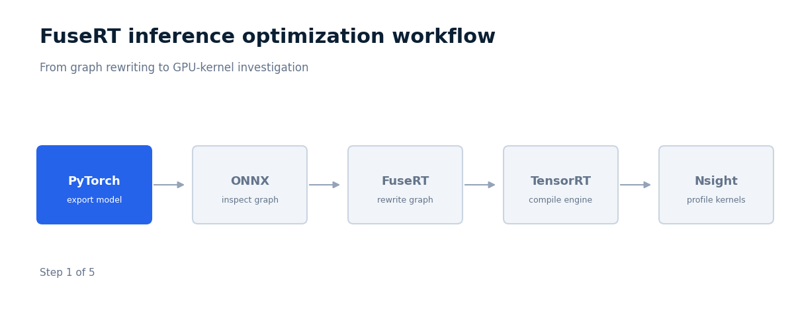

The animation shows the actual progression: the PyTorch model is exported to ONNX, FuseRT rewrites the graph, TensorRT compiles it, and the resulting GPU execution is profiled.

### What each tool does

| Component | Role in FuseRT |
|---|---|
| PyTorch | Defines and exports BERT |
| ONNX | Explicit computation-graph representation |
| ONNX GraphSurgeon | Lets FuseRT inspect and rewrite the graph |
| ONNX Runtime | Measures ONNX execution with and without graph optimization |
| TensorRT | Compiles ONNX into an NVIDIA-GPU-specific engine |
| FuseRT profiler | Measures individual TensorRT engine layers |
| Nsight Systems | Shows the GPU timeline and kernel launches |
| Nsight Compute | Analyzes individual CUDA kernels in depth |

## 2. Why ONNX is used

The original BERT model is written in PyTorch, but PyTorch code does not always expose the exact low-level operation graph that will execute on the GPU.

The exported ONNX graph exposes operations such as:

```text
MatMul, Add, ReduceMean, Pow, Sqrt, Div, Erf, Softmax, Reshape, Transpose
```

FuseRT searches this graph for known patterns and replaces them with simpler graph operations.

ONNX is therefore not the whole inference optimization process. It is the editable intermediate representation used for graph-level optimization.

## 3. What FuseRT changed in the graph

The original BERT graph contained **1,231 nodes**. FuseRT reduced it to **599 nodes**.

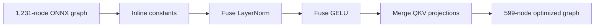

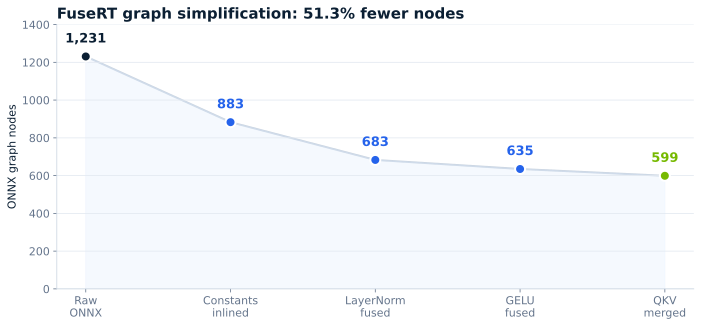

### Graph transformation passes

| Pass | What it does | Result |
|---|---|---:|
| Inline constants | Moves constant values into initializer tensors | 1,231 → 883 nodes |
| Remove Identity | Removes unnecessary identity/copy nodes | 883 → 883 |
| Fuse LayerNorm | Replaces long normalization subgraphs with `LayerNormalization` | 883 → 683 |
| Fuse GELU | Replaces GELU operation chains with `Gelu` | 683 → 635 |
| Merge QKV | Combines Query, Key, and Value projection branches | 635 → 599 |
| Dead-code elimination | Removes unused graph nodes | 599 → 599 |

Overall node reduction:

```text
1,231 − 599 = 632 fewer nodes
632 / 1,231 = 51.3% reduction
```

## 4. Attention inside one BERT encoder block

Each of BERT’s 12 encoder blocks contains an attention sequence:

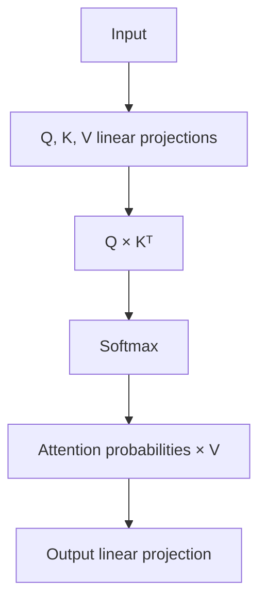

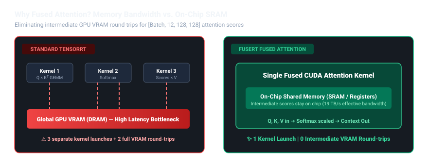

The central attention calculation is:

```text
Q × Kᵀ → Softmax → Scores × V
```

There is one of these sequences in every encoder block, so the model contains 12 instances.

## 5. Correctness verification

Before benchmarking, FuseRT compared the original and optimized ONNX models on four input configurations:

| Batch | Sequence length | Padding | Maximum absolute error | Result |
|---:|---:|---|---:|---|
| 1 | 128 | No | 1.57e-05 | PASS |
| 4 | 64 | No | 8.58e-06 | PASS |
| 8 | 256 | No | 2.19e-05 | PASS |
| 4 | 128 | Yes | 8.94e-06 | PASS |

All errors are below the project tolerance of approximately `1e-4`.

## 6. TensorRT layer structure

TensorRT converted both the original and optimized ONNX graphs into **197 engine layers**.

| TensorRT layer category | Count | RTX 3060 time | RTX 5090 time |
|---|---:|---:|---:|
| GEMM | 73 | 4.925 ms | 2.371 ms |
| `kgen` generated kernels | 75 | 1.589 ms | 0.977 ms |
| Cast | 24 | 0.220 ms | 0.138 ms |
| Reshape | 24 | 0.149 ms | 0.191 ms |
| Shape call | 1 | 0.019 ms | 0.004 ms |
| **Total profiled layer time** | **197** | **6.901 ms** | **3.681 ms** |

The layer count is the same because TensorRT already recognizes and applies many of the graph fusions that FuseRT performs.

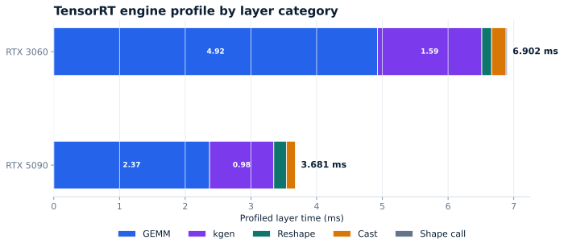

## 7. ONNX Runtime comparison

These are p50 latency results in milliseconds at sequence length 128.

### ORT graph optimization disabled

| Batch | RTX 3060 original | RTX 3060 optimized | RTX 5090 original | RTX 5090 optimized |
|---:|---:|---:|---:|---:|
| 1 | 15.68 | 7.39 | 7.24 | 3.56 |
| 8 | 36.68 | 29.38 | 7.67 | 4.97 |
| 32 | 130.32 | 106.10 | 18.07 | 13.29 |

### ORT graph optimization enabled

| Batch | RTX 3060 original | RTX 3060 optimized | RTX 5090 original | RTX 5090 optimized |
|---:|---:|---:|---:|---:|
| 1 | 7.15 | 6.12 | 3.80 | 3.11 |
| 8 | 27.01 | 27.19 | 5.24 | 5.03 |
| 32 | 96.78 | 99.52 | 13.11 | 12.61 |

### Interpretation

FuseRT gives the largest ONNX Runtime improvement when ORT's own graph optimizer is disabled. When ORT optimization is enabled, ORT already performs many similar transformations.

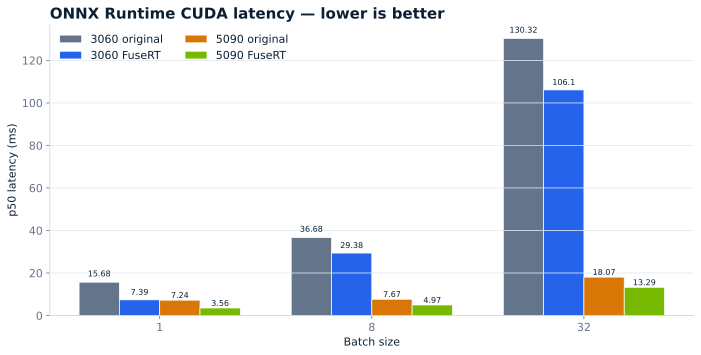

The chart compares both GPUs and both graph versions. Lower latency is better.

## 8. TensorRT comparison

These are p50 TensorRT inference latencies in milliseconds at sequence length 128.

| Batch | RTX 3060 original | RTX 3060 optimized | RTX 5090 original | RTX 5090 optimized |
|---:|---:|---:|---:|---:|
| 1 | 3.83 | 3.93 | 2.70 | 2.60 |
| 8 | 19.98 | 20.33 | 2.95 | 2.93 |
| 32 | 78.17 | 77.96 | 9.17 | 9.16 |

### TensorRT engine-build comparison on RTX 5090

| Metric | Original ONNX | Optimized ONNX |
|---|---:|---:|
| Build time | 7.8 s | 6.8 s |
| Engine size | 439.0 MB | 438.9 MB |
| TensorRT layers | 197 | 197 |
| Activation memory | 140.5 MB | 140.5 MB |
| Weight memory | 437.9 MB | 437.9 MB |

The RTX 5090 optimized engine is only marginally faster. This demonstrates that ONNX graph rewriting alone does not substantially beat TensorRT for this model.

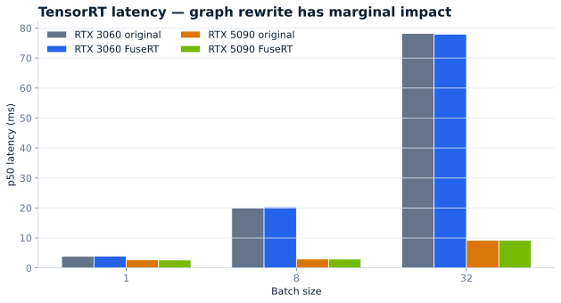

## 9. Attention bottleneck comparison

| Attention category | Count | RTX 3060 time | RTX 5090 time |
|---|---:|---:|---:|
| QKV projection GEMM | 12 | 0.995 ms | 0.410 ms |
| Output projection GEMM | 12 | 0.993 ms | 0.412 ms |
| `Q × Kᵀ` GEMM | 12 | 0.658 ms | 0.404 ms |
| Attention transpose candidates | 24 | 0.677 ms | 0.325 ms |
| Scores `× V` GEMM | 12 | 0.511 ms | 0.242 ms |
| Softmax | 12 | 0.417 ms | 0.159 ms |

The central FuseRT target is:

```text
Q × Kᵀ + Softmax + Scores × V
```

| GPU | Target time | Share of profiled layer time |
|---|---:|---:|
| RTX 3060 | 1.586 ms | 23.0% |
| RTX 5090 | 0.804 ms | 21.8% |

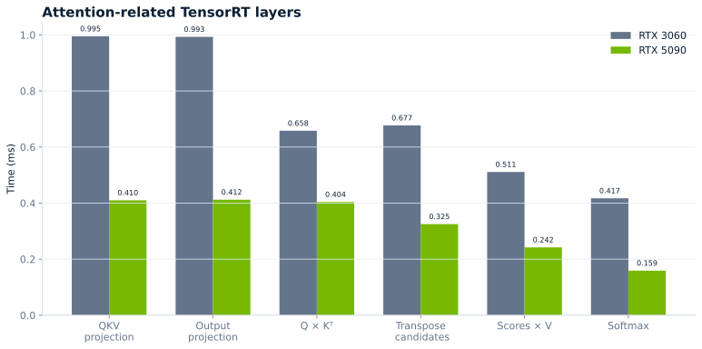


The RTX 5090 reduces the absolute time, but attention remains a similar fraction of the profiled runtime. This makes it a reasonable target for deeper GPU investigation.

## 10. Attention pattern matching

FuseRT scanned the optimized ONNX graph and found:

```text
attention matches: 12
skipped softmax nodes: 0
```

For every encoder block it located the exact sequence:

```text
Q × Kᵀ
→ Softmax
→ Scores × V
```

This confirms that the graph contains 12 complete attention patterns that could be candidates for a future custom TensorRT plugin.

## 11. What has been completed

- Exported BERT-base to ONNX on the RTX 5090 environment.
- Counted the original 1,231-node graph.
- Applied FuseRT graph transformations and produced the 599-node graph.
- Verified numerical equivalence across four input configurations.
- Built original and optimized TensorRT engines on the RTX 5090.
- Confirmed both engines contain 197 TensorRT layers.
- Benchmarked ONNX Runtime on the RTX 5090.
- Benchmarked TensorRT on the RTX 5090.
- Profiled all 197 TensorRT layers on the RTX 5090.
- Identified the central attention sequence as a 0.804 ms / 21.8% target.
- Located all 12 attention patterns with zero skipped matches.

## 12. What remains

The next phase is deeper GPU analysis:

1. Use **Nsight Systems** to inspect the timeline, kernel launches, synchronization, and memory-copy activity.
2. Use **Nsight Compute** on selected attention kernels.
3. Inspect memory throughput, cache behavior, register usage, occupancy, and Tensor Core utilization.
4. Implement or complete a fused attention TensorRT plugin.
5. Verify numerical correctness again.
6. Compare the plugin against the original TensorRT engine end to end.

The goal is not merely to reduce the ONNX node count. The goal is to reduce real GPU execution time beyond what TensorRT already achieves.

## 13. Reproducibility commands

Run these commands from the RTX 5090 project directory with the virtual environment activated:

```bash
python models/export_bert.py
python -m fusert.stats models/bert.onnx
python -m fusert.optimize models/bert.onnx models/bert_opt.onnx
python -m fusert.verify models/bert.onnx models/bert_opt.onnx
python bench/build_trt.py models/bert.onnx models/bert_fp32.plan results/trt_original_layers.json
python bench/build_trt.py models/bert_opt.onnx models/bert_opt_fp32.plan results/trt_optimized_layers.json
python bench/bench_ort.py
python bench/bench_trt.py
python bench/profile_trt_layers.py models/bert_fp32.plan results/trt_original_layers.json 1 results/profile_original_b1.json
python bench/attention_breakdown.py results/profile_original_b1.json results/trt_original_layers.json results/attention_breakdown_b1.json
python fusert/fuse_attention.py models/bert_opt.onnx results/attention_pattern_matches.json
```

## 14. Existing visual assets

The repository already contains several visual assets under `docs/assets/`:

- `pipeline_flow.svg`
- `node_reduction_chart.svg`
- `ort_speedup_chart.svg`
- `trt_layer_profile.svg`
- `attention_fusion_visual.svg`

The polished comparison visuals are in `docs/assets/professional/`:

- `fusert_workflow.gif`
- `graph_reduction.svg`
- `ort_latency_comparison.svg`
- `trt_latency_comparison.svg`
- `trt_layer_profile_comparison.svg`
- `attention_breakdown_comparison.svg`

These can be embedded in GitHub-compatible Markdown with:

```markdown
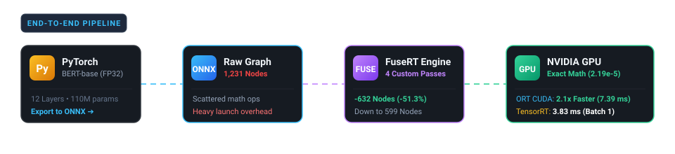
```

